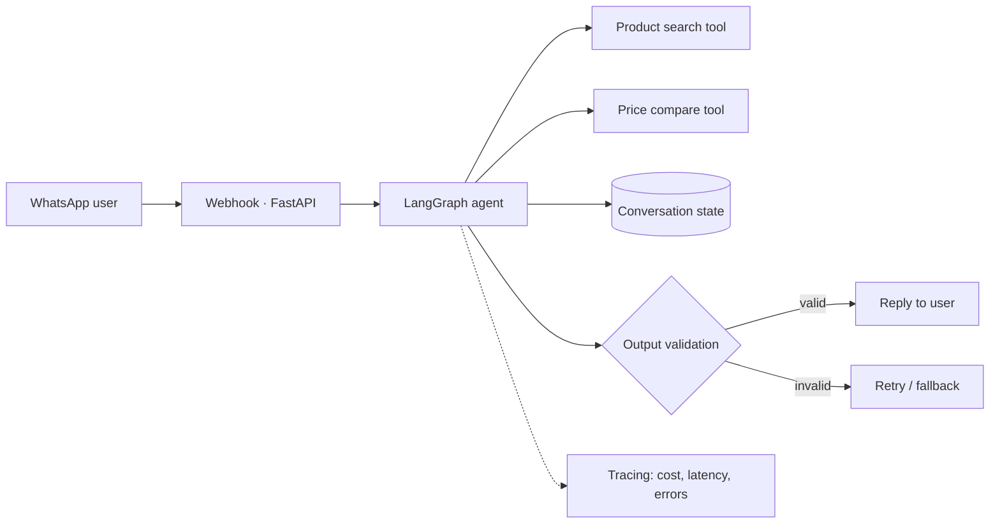

<div align="center">


**I build LLM agents that call real tools, and I measure whether they work.**
BS Artificial Intelligence (2026) · Python / FastAPI / LangGraph · Open to remote roles with US & Canadian teams

<a href="https://www.linkedin.com/in/haziq-imran-778760312"></a>
<a href="mailto:hazziq595959@gmail.com"></a>
<a href="YOUR_PORTFOLIO_URL"></a>
<a href="YOUR_RESUME_PDF_LINK"></a>

</div>

---

## 📌 At a glance

| | |
|---|---|
| **Role I'm targeting** | Junior / Early-Career AI Engineer (LLM applications, agents, RAG) |
| **Location & hours** | Rahim Yar Khan, Pakistan (UTC+5). Happy to overlap 4–6 hrs with EST/PST, async-first |
| **Languages** | English (C1), Urdu (native) |
| **Strongest at** | Turning an agent idea into a working API with tools, state, and tests |
| **Currently improving** | Evaluation suites, tracing, guardrails, retrieval quality |
| **Availability** | `[Full-time / contract, start date]` |

---

## 🚀 Featured projects

> Each project: the problem, how it's built, and the **proof it works**. Replace every `[ ]` with your real numbers. If you don't have a number yet, run the eval and get one before you publish.

### 1. 🛒 WhatsApp Shopping Agent
**Problem:** Comparing prices across stores means opening ten tabs. This agent does it inside a WhatsApp chat.


<sub>↑ Edit this diagram to match your real architecture. Recruiters read diagrams before code.</sub>

| Engineering proof | Result |
|---|---|
| Test set of real queries | `[N]` queries, `[X]%` returned the correct cheapest option |
| Median / p95 latency | `[ ] s / [ ] s` |
| Cost per conversation | `$[ ]` |
| Failure handling | `[what happens when a store API times out or the model returns bad JSON]` |
| Known limitation | `[one honest sentence]` |

**Stack:** Python · FastAPI · LangGraph · `[LLM provider]` · `[DB]` · Docker
🔗 [Live demo](#) · [Code](#) · [Architecture write-up](#)

---

### 2. 🎓 Scholarship Guidance Assistant
**Problem:** Students miss funding because eligibility rules are scattered and confusing.
**Approach:** `[retrieval over scholarship data? structured eligibility matching? describe in one line]`

| Engineering proof | Result |
|---|---|
| Answer accuracy on `[N]` hand-checked questions | `[X]%` |
| How it handles "not in the data" | `[refuses / cites source / escalates]` |

🔗 [Live demo](#) · [Code](#)

---

### 3. ✉️ Professor Outreach Tool
**Problem:** Cold emails to professors are generic and get ignored.
**Approach:** `[how it researches a professor and personalizes; where a human reviews before sending]`

| Engineering proof | Result |
|---|---|
| Human-in-the-loop step | `[yes/no, where]` |
| Hallucination control | `[how you stop it inventing papers]` |

🔗 [Live demo](#) · [Code](#)

---

## 🧪 How I work

```text
Spec the task → Build the smallest working agent → Write an eval set → Break it on purpose → Fix → Re-run evals
```

What I do on every serious project:

- **Typed everything.** Pydantic models for tool inputs and LLM outputs, so bad JSON fails loudly instead of silently.
- **Eval before polish.** A small golden dataset lives in the repo and runs on every change.
- **Plan for model failure.** Timeouts, retries, and a defined fallback, not a stack trace to the user.
- **Know the bill.** Token cost and latency are logged per request.

> *Does it work? Can we measure it? What happens when the model gets it wrong?*

---

## 🧰 Tech I can defend in an interview

<div align="center">


</div>

| Daily use | Working knowledge | Learning now |
|---|---|---|
| Python, FastAPI, LangGraph, tool calling | Pinecone, Docker, MCP, Streamlit | Evaluation (Ragas / DeepEval), Langfuse tracing, pgvector, hybrid search + reranking |

<sub>Only list what you could build live in an interview. Move anything shaky to "Learning now".</sub>

---

## 📈 GitHub activity

<div align="center">


</div>

---

<div align="center">

**Looking for a junior AI engineer who ships, tests, and explains tradeoffs?**
[Email me](mailto:hazziq595959@gmail.com) · [LinkedIn](https://www.linkedin.com/in/haziq-imran-778760312)


</div>
